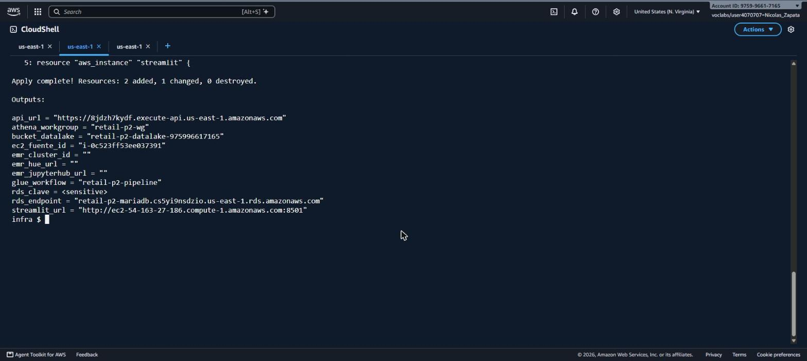
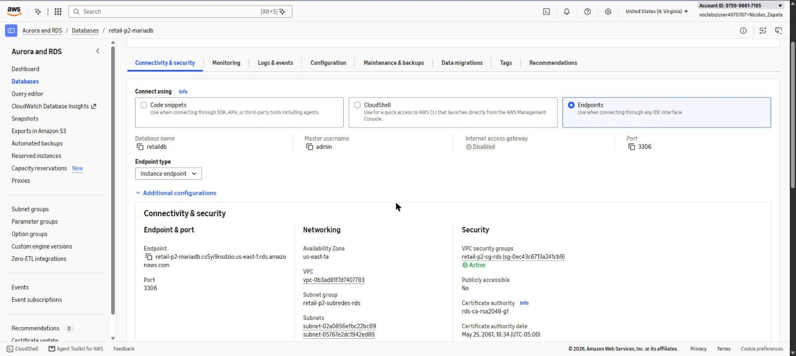
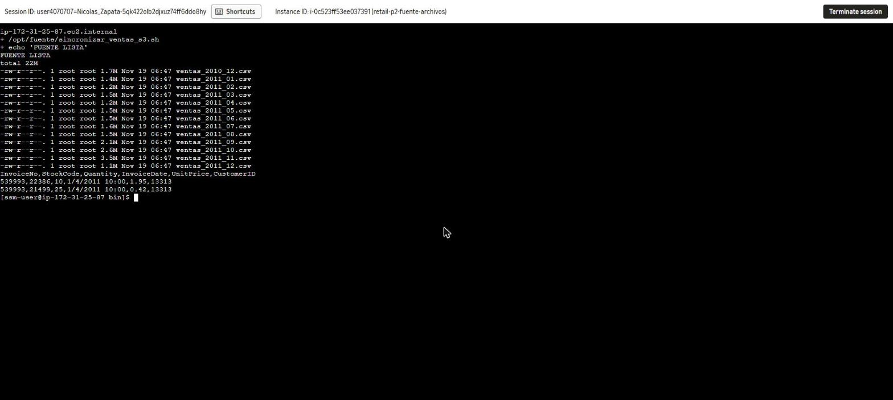
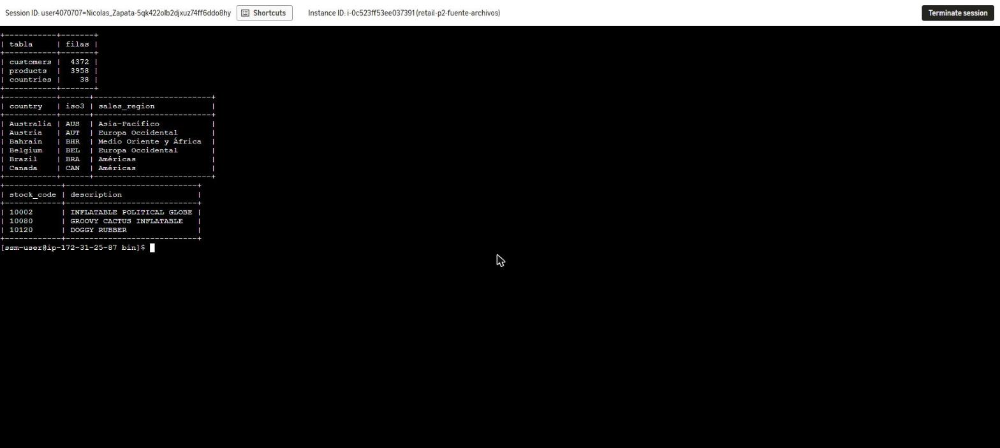
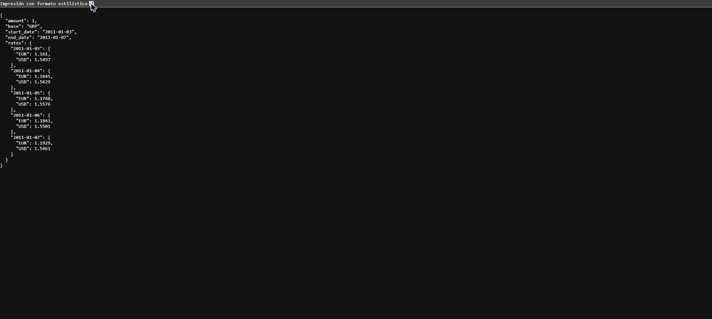

# Evidencias · 02-fuentes-de-datos

Capturas del despliegue real en AWS Academy (19-nov-2026). Son las mismas que van en el informe; el nombre del archivo es el id de la evidencia.

| Id | Captura |
|---|---|
| [E01](E01.jpg) | CloudShell: final de `terraform apply` con los *outputs* |
| [E02](E02.jpg) | Consola RDS: `retail-p2-mariadb` en estado *Available*, *Publicly accessible = No* |
| [E03](E03.jpg) | Session Manager en la EC2 fuente: `FUENTE LISTA` en el log y `ls -lh /srv/ventas` con los 13 archivos |
| [E04](E04.jpg) | Session Manager: conteos de las 3 tablas de MariaDB y `SELECT * FROM countries LIMIT 5` |
| [E05](E05.jpg) | Navegador con una de las URLs (Frankfurter o Banco Mundial) mostrando el JSON |

## Capturas

### E01

### E02

### E03

### E04

### E05

