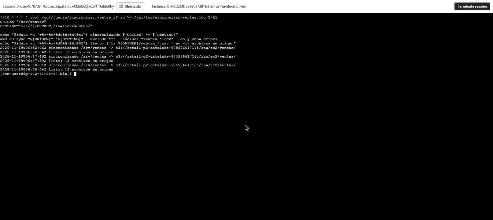
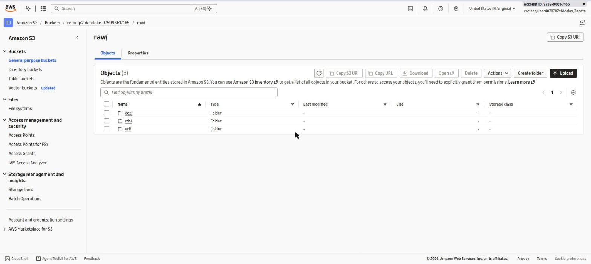
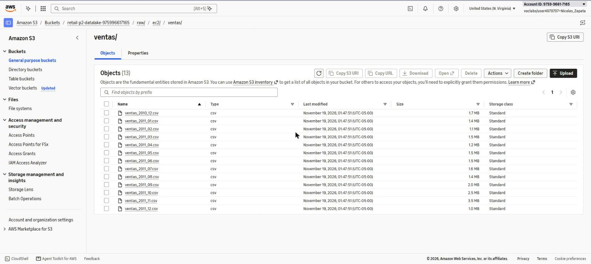
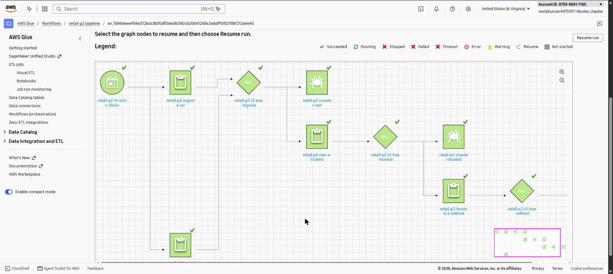
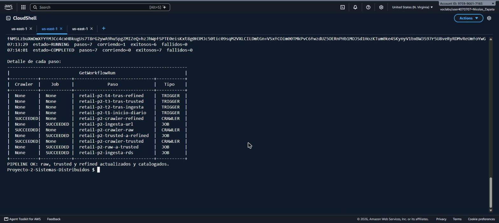

# Evidencias · 03-ingesta

Capturas del despliegue real en AWS Academy (19-nov-2026). Son las mismas que van en el informe; el nombre del archivo es el id de la evidencia.

| Id | Captura |
|---|---|
| [E06](E06.jpg) | EC2 fuente: `cat /etc/cron.d/sincronizar-ventas` y el final de `/var/log/sincronizar-ventas.log` |
| [E07](E07a.jpg) | Consola S3: carpetas `raw/rds/`, `raw/ec2/ventas/` y `raw/url/` con sus archivos |
| [E08](E08.jpg) | Glue → Workflows → `retail-p2-pipeline` → *History* → *View run details*: el grafo completo en verde |
| [E09](E09.jpg) | Glue → ETL jobs: `retail-p2-ingesta-rds` y `retail-p2-ingesta-url` en *Succeeded* |

## Capturas

### E06

### E07

### E08

### E09

