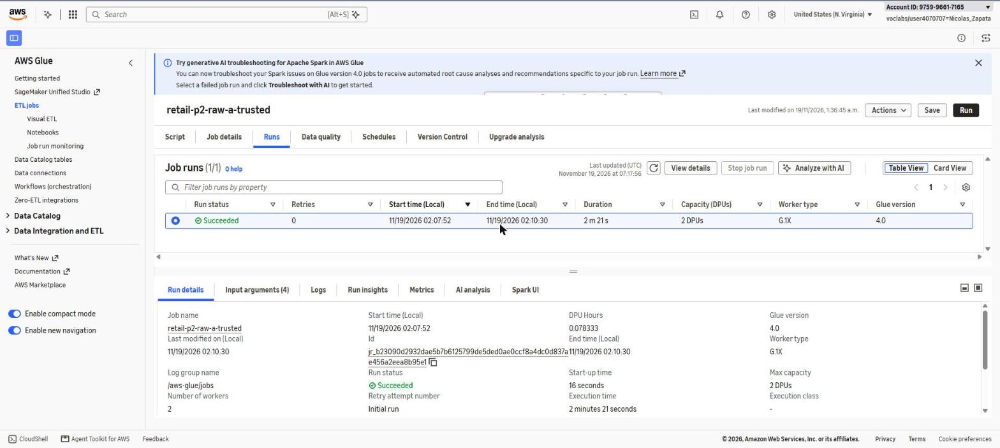
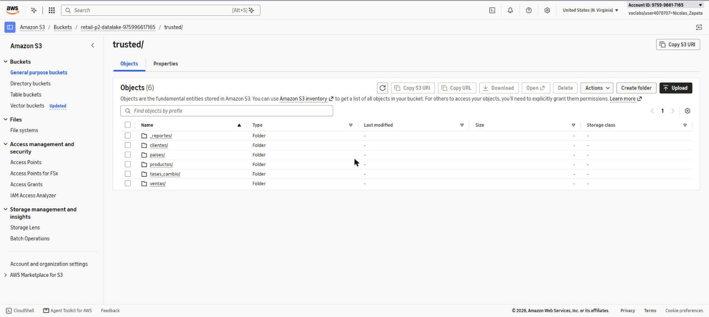
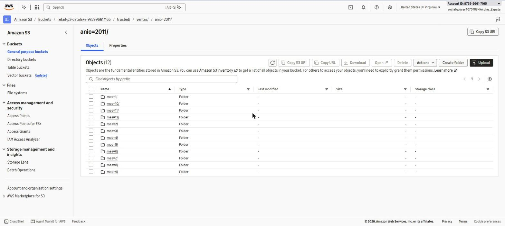
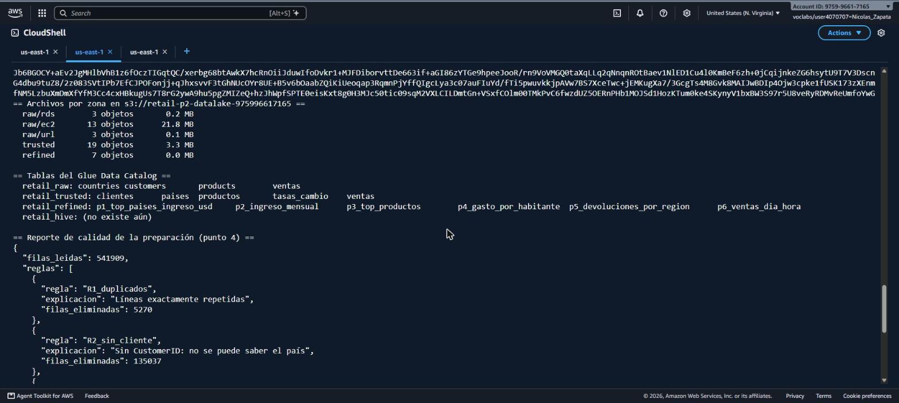
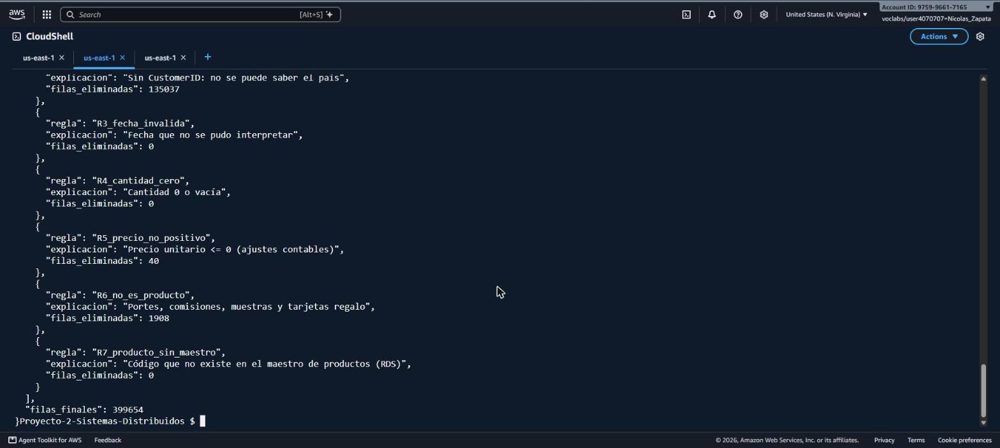

# Evidencias · 04-preparacion

Capturas del despliegue real en AWS Academy (19-nov-2026). Son las mismas que van en el informe; el nombre del archivo es el id de la evidencia.

| Id | Captura |
|---|---|
| [E10](E10.jpg) | Glue → `retail-p2-raw-a-trusted` → *Runs*: ejecución *Succeeded* (y pestaña *Script*) |
| [E11](E11a.jpg) | Consola S3: `trusted/` con sus 5 carpetas y `trusted/ventas/anio=2011/` con las particiones por mes |
| [E12](E12a.jpg) | Contenido de `trusted/_reportes/calidad_ventas.json` (desde `scripts/verificar_datalake.sh`) |

## Capturas

### E10

### E11

### E12

