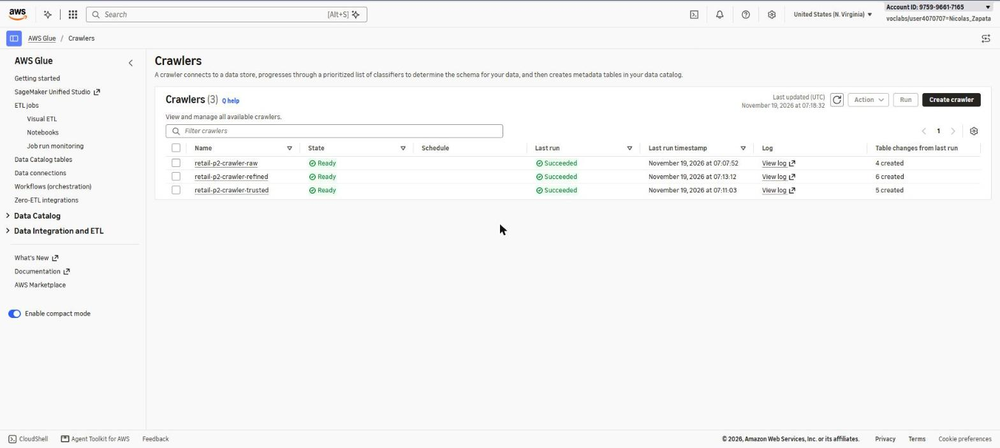
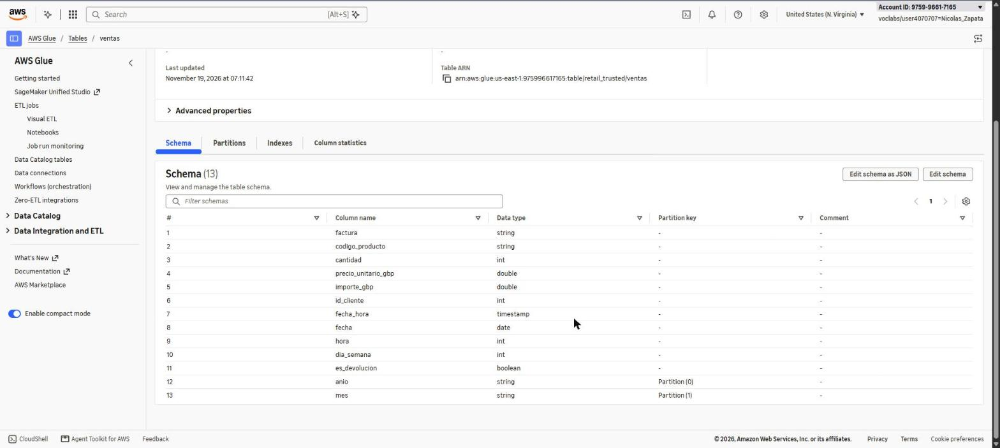
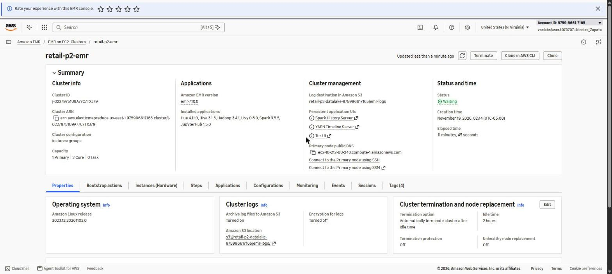
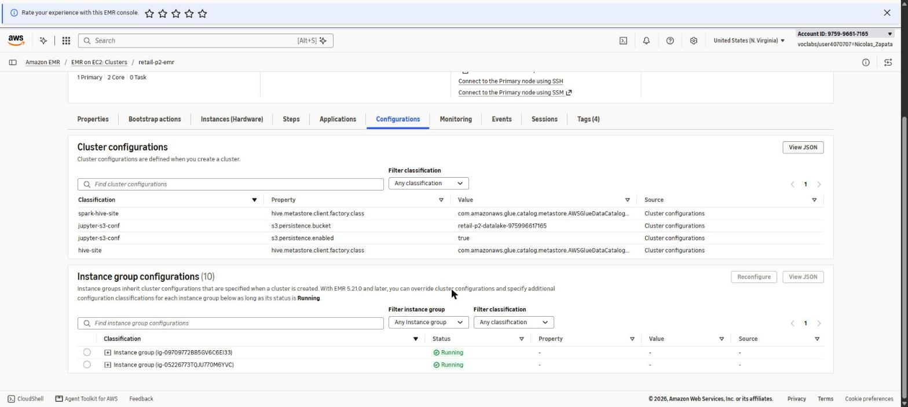
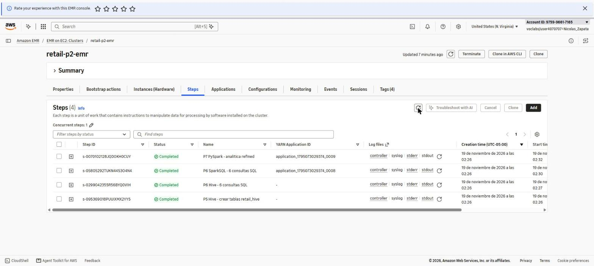
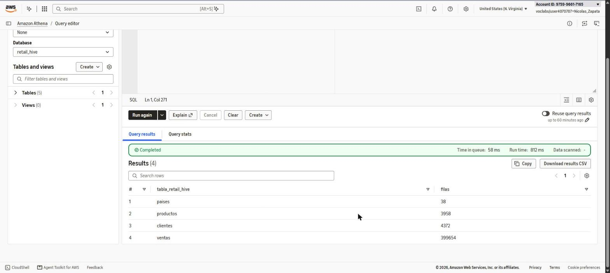

# Evidencias · 05-catalogacion

Capturas del despliegue real en AWS Academy (19-nov-2026). Son las mismas que van en el informe; el nombre del archivo es el id de la evidencia.

| Id | Captura |
|---|---|
| [E13](E13.jpg) | Glue → Crawlers: los 3 crawlers con la última ejecución *Succeeded* y tablas creadas |
| [E14](E14.jpg) | Glue → Data Catalog → Tables → `retail_trusted.ventas`: esquema con tipos y particiones `anio`, `mes` |
| [E15](E15a.jpg) | Consola EMR: clúster `retail-p2-emr` en *Waiting* y pestaña *Configurations* con `hive-site` (Glue como metastore) |
| [E16](E16.jpg) | EMR → Steps: "P5 Hive - crear tablas retail_hive" *Completed* (o Hue con `SHOW TABLES` en `retail_hive`) |
| [E17](E17.jpg) | Athena (o Glue) mostrando la base `retail_hive` creada desde Hive y una consulta sobre ella |

## Capturas

### E13

### E14

### E15

### E16

### E17

