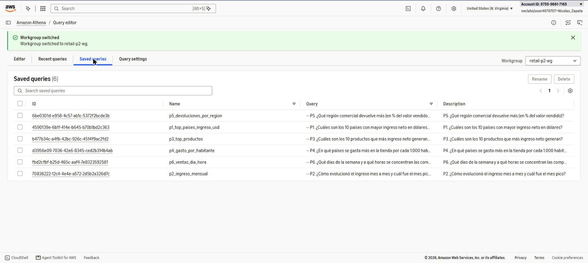
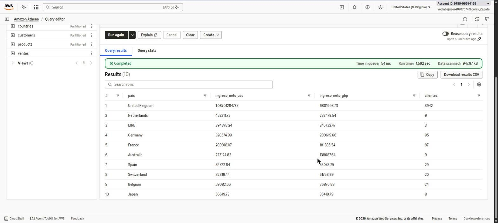
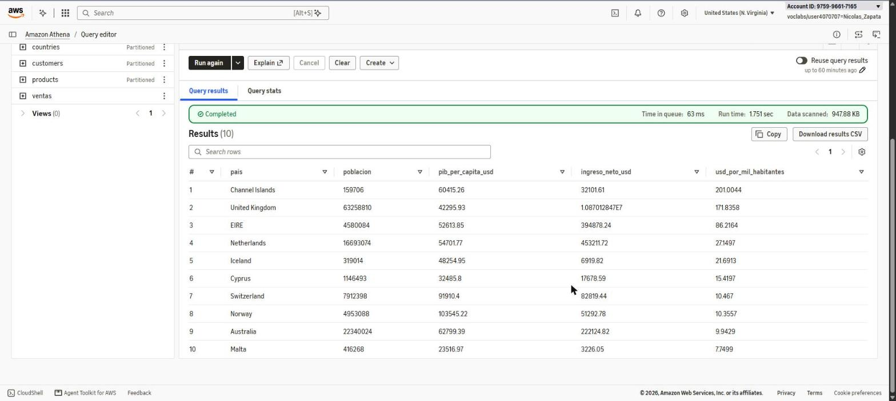
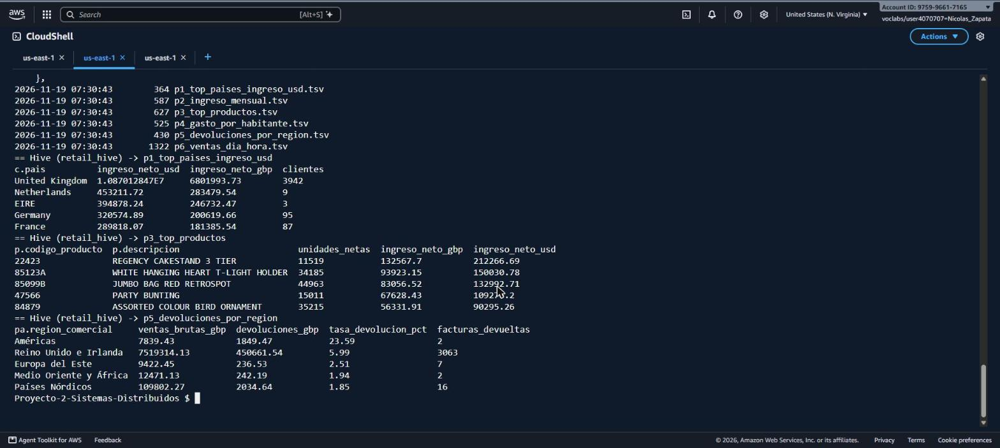
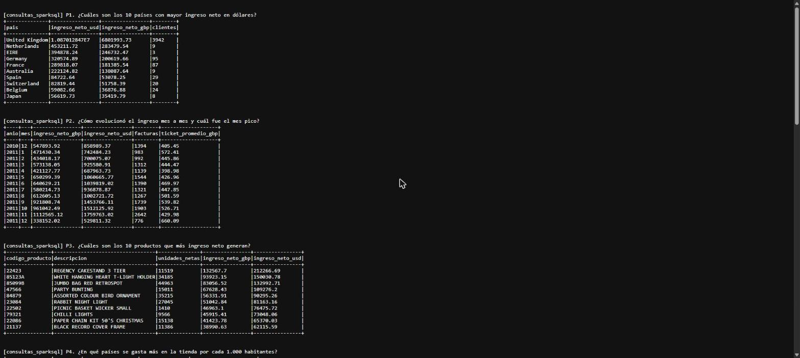

# Evidencias · 06-consultas-sql

Capturas del despliegue real en AWS Academy (19-nov-2026). Son las mismas que van en el informe; el nombre del archivo es el id de la evidencia.

| Id | Captura |
|---|---|
| [E18](E18a.jpg) | Athena: lista de *Saved queries* del workgroup `retail-p2-wg` y resultado de P1 |
| [E19](E19.jpg) | Athena: resultado de P4 o P5 (con "Data scanned" y tiempo de ejecución) |
| [E20](E20.jpg) | Hive: resultado de una consulta (Hue, o stdout del step "P6 Hive") |
| [E21](E21.jpg) | SparkSQL: stdout del step "P6 SparkSQL" con las 6 tablas de resultado |

## Capturas

### E18

### E19

### E20

### E21

