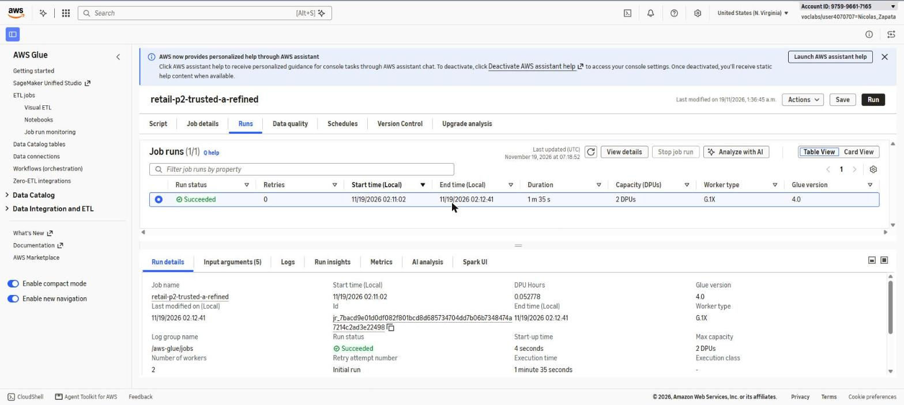
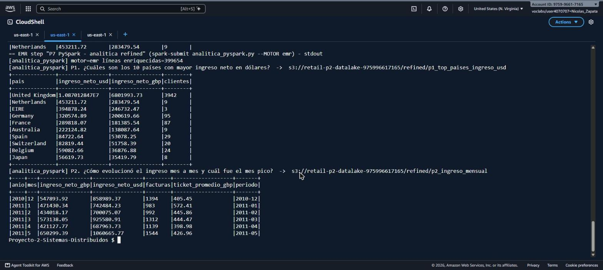
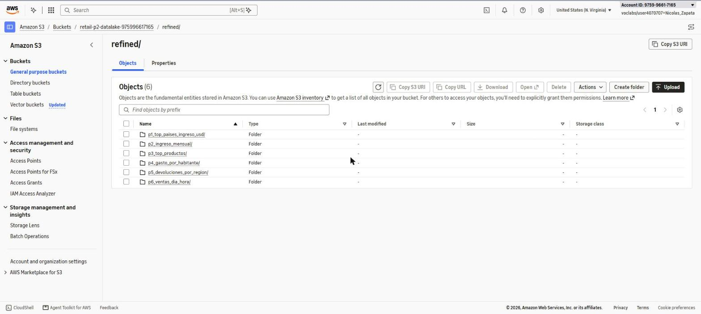

# Evidencias · 07-pyspark

Capturas del despliegue real en AWS Academy (19-nov-2026). Son las mismas que van en el informe; el nombre del archivo es el id de la evidencia.

| Id | Captura |
|---|---|
| [E22](E22.jpg) | Glue → `retail-p2-trusted-a-refined` *Succeeded* (o su log con las tablas impresas) |
| [E23](E23.jpg) | EMR: stdout del step "P7 PySpark" o el notebook en JupyterHub con resultados |
| [E24](E24.jpg) | S3 `refined/` con las 6 carpetas y Glue → tablas de `retail_refined` |

## Capturas

### E22

### E23

### E24

