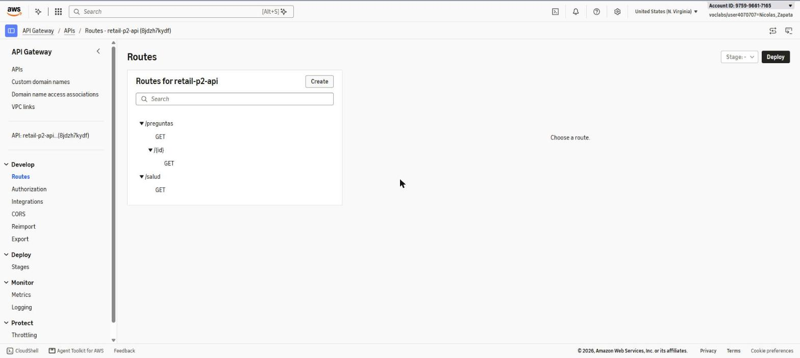
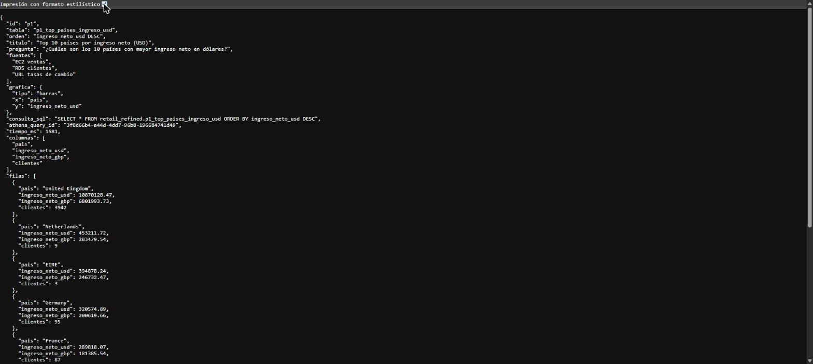
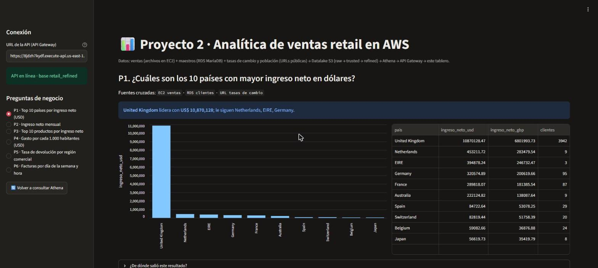
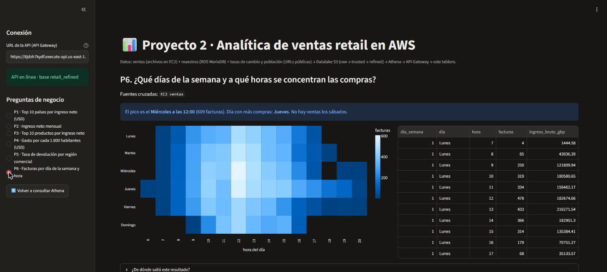
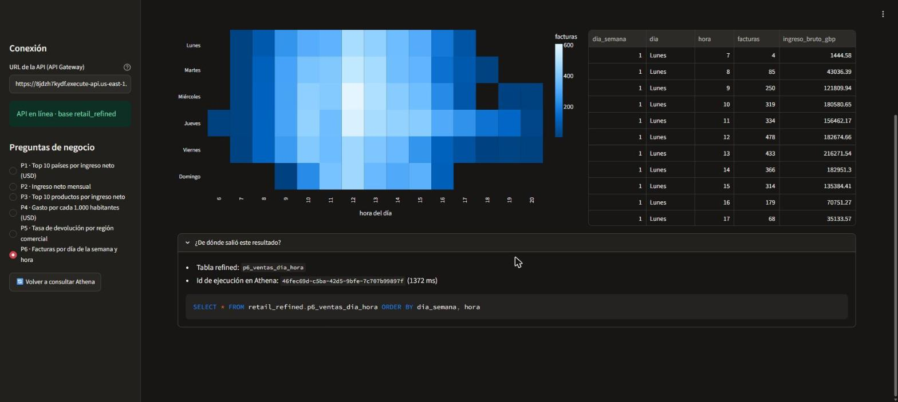
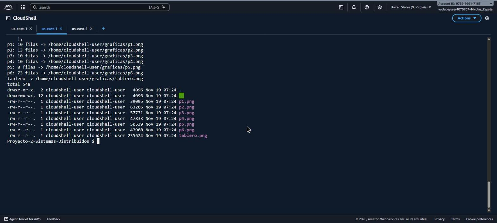
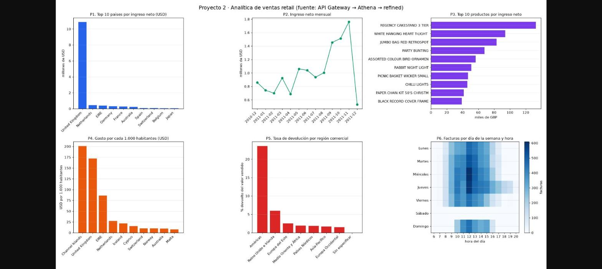

# Evidencias · 08-visualizacion-y-api

Capturas del despliegue real en AWS Academy (19-nov-2026). Son las mismas que van en el informe; el nombre del archivo es el id de la evidencia.

| Id | Captura |
|---|---|
| [E25](E25a.jpg) | API Gateway → `retail-p2-api` → *Routes*, y el navegador/curl con `…/preguntas/p1` en JSON |
| [E26](E26.jpg) | Tablero Streamlit en la URL pública: P1 con gráfica, tabla y respuesta en una frase |
| [E27](E27a.jpg) | Tablero Streamlit: P6 (mapa de calor) con el desplegable "¿De dónde salió este resultado?" abierto |
| [E28](E28a.jpg) | `tablero.png` generado con matplotlib |

## Capturas

### E25

### E26

### E27

### E28

