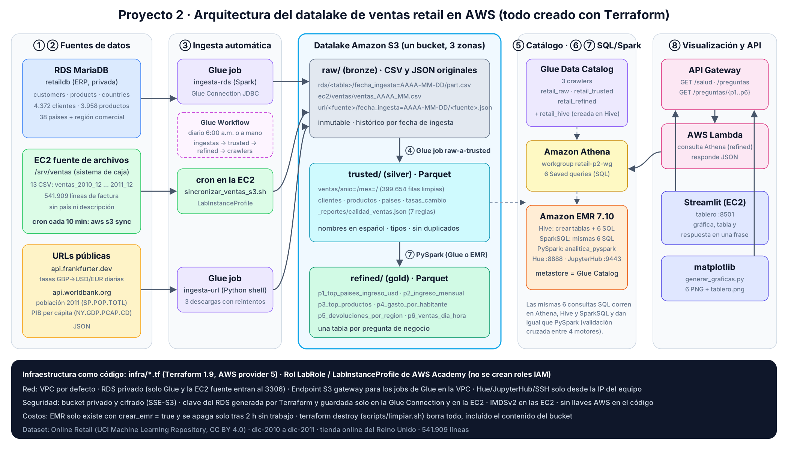
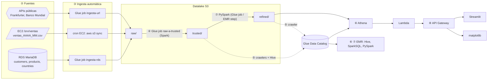

# Proyecto 2 · Big Data en AWS — Analítica de ventas retail

**SI3007 Sistemas Distribuidos · Universidad EAFIT · 2026-2**
Integrantes: **Nicolás Zapata**, **Abraham Navarro**, **Samuel Henao**

Un datalake completo en AWS, creado de principio a fin con **Terraform**, que toma datos de **tres fuentes**
(una base de datos RDS MariaDB, archivos en una EC2 y APIs públicas por URL), los ingiere automáticamente a
**S3** (raw → trusted → refined), los prepara con **AWS Glue + Apache Spark**, los cataloga con **Glue y
EMR/Hive**, los consulta con **Athena, Hive y SparkSQL**, los analiza con **PySpark** y publica las respuestas
en una **API (API Gateway + Lambda)** que consume un tablero **Streamlit** y un reporte **matplotlib**.



---

## El caso de estudio en 30 segundos

Una tienda online del Reino Unido (dataset público *Online Retail*, UCI) vende artículos de regalo a clientes
de 38 países entre dic-2010 y dic-2011. La información está repartida como en una empresa real:

| Fuente | Dónde vive | Qué tiene | Por qué hace falta |
|---|---|---|---|
| **Base de datos** | RDS MariaDB `retaildb` | clientes (y su país), productos (y su descripción), países (ISO-3 y región comercial) | las ventas solo traen códigos |
| **Archivos** | EC2, carpeta `/srv/ventas` | 13 CSV mensuales con 541.909 líneas de factura (exporte del sistema de caja) | son los hechos: qué se vendió, cuándo y a quién |
| **URLs** | `api.frankfurter.dev`, `api.worldbank.org` | tasas de cambio GBP→USD/EUR diarias; población y PIB per cápita 2011 | pasar libras a dólares y medir gasto por habitante |

Con eso respondemos **6 preguntas de negocio** ([detalle en 01-caso-de-estudio](01-caso-de-estudio/README.md)):

| # | Pregunta | Fuentes que cruza |
|---|---|---|
| P1 | ¿Cuáles son los 10 países con mayor ingreso neto en dólares? | EC2 + RDS + URL |
| P2 | ¿Cómo evolucionó el ingreso mes a mes y cuál fue el mes pico? | EC2 + URL |
| P3 | ¿Cuáles son los 10 productos que más ingreso neto generan? | EC2 + RDS + URL |
| P4 | ¿En qué países se gasta más por cada 1.000 habitantes? | EC2 + RDS + URL (2 APIs) |
| P5 | ¿Qué región comercial devuelve más (en % del valor vendido)? | EC2 + RDS |
| P6 | ¿Qué días de la semana y a qué horas se concentran las compras? | EC2 |

---

## Dónde está cada punto del enunciado

Cada punto tiene su carpeta con su `README.md` (qué se pidió, qué hicimos, archivos, cómo se conectan, cómo
verificarlo) y su carpeta `evidencias/`. La infraestructura de todos los puntos está en [`infra/`](infra/README.md).

| Punto del enunciado | Carpeta | Código principal | Recurso AWS (Terraform) |
|---|---|---|---|
| 1. Caso de estudio y preguntas | [`01-caso-de-estudio`](01-caso-de-estudio/README.md) | — | — |
| 2. Fuentes: RDS, EC2, URL | [`02-fuentes-de-datos`](02-fuentes-de-datos/README.md) | `preparar_fuentes.py`, `sql/esquema_mariadb.sql` | `fuente_rds.tf`, `fuente_ec2.tf` |
| 3. Ingesta automática a S3 | [`03-ingesta`](03-ingesta/README.md) | `glue/ingesta_rds.py`, `glue/ingesta_url.py`, `ec2/sincronizar_ventas_s3.sh` | `glue_jobs.tf`, `glue_workflow.tf` |
| 4. Preparación raw → trusted (Glue + Spark) | [`04-preparacion`](04-preparacion/README.md) | `glue/raw_a_trusted.py` | `glue_jobs.tf` |
| 5. Catalogación (Glue y EMR/Hive) | [`05-catalogacion`](05-catalogacion/README.md) | `hive/crear_tablas_hive.hql` | `glue_catalogo.tf`, `emr.tf` |
| 6. SQL con Athena, Hive y SparkSQL | [`06-consultas-sql`](06-consultas-sql/README.md) | `sql/p1…p6.sql`, `hive/…sh`, `sparksql/…py` | `athena.tf`, `emr.tf` |
| 7. Analítica con PySpark | [`07-pyspark`](07-pyspark/README.md) | `analitica_pyspark.py`, `analitica_emr.ipynb` | `glue_jobs.tf`, `emr.tf` |
| 8. Visualización + API Gateway + Streamlit | [`08-visualizacion-y-api`](08-visualizacion-y-api/README.md) | `api/lambda_function.py`, `streamlit/app.py`, `matplotlib/generar_graficas.py` | `api.tf`, `app_streamlit.tf` |

---

## Cómo se conecta todo (el recorrido de un dato)



1. `terraform apply` crea todo y sube el código del repo a `s3://<bucket>/scripts/`.
2. La **EC2 fuente** arranca, corre `preparar_fuentes.py` (reparte el dataset en sus 13 CSV y en los INSERT del
   RDS), carga el **RDS** y programa un **cron** que sube sus CSV a `raw/ec2/` cada 10 minutos.
3. El **Glue Workflow** (diario a las 6:00 a.m. Colombia, o a mano con `scripts/ejecutar_pipeline.sh`) corre:
   `ingesta-rds` + `ingesta-url` → `raw-a-trusted` + crawler raw → crawler trusted + `trusted-a-refined` →
   crawler refined.
4. **Athena** consulta `retail_trusted` (6 *Saved queries*) y **EMR** corre Hive, SparkSQL y PySpark sobre las
   mismas tablas, porque usa el Glue Data Catalog como metastore.
5. La **Lambda** consulta `retail_refined` en Athena; **API Gateway** la publica; **Streamlit** y **matplotlib**
   la consumen.

**Una sola fuente de verdad:** las 6 consultas SQL están escritas una vez (`06-consultas-sql/sql/`) y las ejecutan
Athena, Hive y SparkSQL cambiando solo el nombre de la base (`${db}`); el script PySpark calcula lo mismo con la
API de DataFrames. Los cuatro motores deben dar el mismo resultado: es nuestra validación cruzada.

---

## Estructura del repositorio

```
.
├── README.md                          ← este archivo
├── docs/arquitectura.svg|png          ← diagrama de arquitectura
├── infra/                             ← TERRAFORM: toda la infraestructura (ver infra/README.md)
│   ├── versions.tf  variables.tf  locals.tf  datos_cuenta.tf  outputs.tf
│   ├── red.tf             security groups + endpoint S3
│   ├── s3_datalake.tf     bucket, zonas, subida del código y del dataset
│   ├── fuente_rds.tf      RDS MariaDB                         (punto 2)
│   ├── fuente_ec2.tf      EC2 fuente de archivos + cron       (puntos 2 y 3)
│   ├── glue_catalogo.tf   bases del catálogo + 3 crawlers     (punto 5)
│   ├── glue_jobs.tf       conexión JDBC + 4 jobs              (puntos 3, 4 y 7)
│   ├── glue_workflow.tf   orquestación automática             (punto 3)
│   ├── athena.tf          workgroup + 6 saved queries         (punto 6)
│   ├── emr.tf             clúster EMR (con crear_emr = true) (puntos 5, 6 y 7)
│   ├── api.tf             Lambda + API Gateway                (punto 8)
│   ├── app_streamlit.tf   EC2 con Streamlit                   (punto 8)
│   └── plantillas/        user_data de las dos EC2
├── 01-caso-de-estudio/                preguntas de negocio y diccionario de datos
├── 02-fuentes-de-datos/               preparar_fuentes.py, esquema MariaDB, dataset
├── 03-ingesta/                        glue/ingesta_rds.py, glue/ingesta_url.py, ec2/sincronizar_ventas_s3.sh
├── 04-preparacion/                    glue/raw_a_trusted.py
├── 05-catalogacion/                   hive/crear_tablas_hive.hql
├── 06-consultas-sql/                  sql/p1…p6.sql, hive/ejecutar_consultas_hive.sh, sparksql/consultas_sparksql.py
├── 07-pyspark/                        analitica_pyspark.py, analitica_emr.ipynb
├── 08-visualizacion-y-api/            api/lambda_function.py, streamlit/app.py, matplotlib/generar_graficas.py
└── scripts/                           ayudas para CloudShell: preparar, esperar, ejecutar, verificar, limpiar
```

---

## Reproducir todo el proyecto (resumen)

Requisitos: una sesión activa del **AWS Academy Learner Lab** (región `us-east-1`). Todo se corre en **AWS CloudShell**,
que ya tiene las credenciales del laboratorio.

```bash
# 0. Traer el código y preparar Terraform (una vez por sesión de CloudShell)
git clone https://github.com/Nicolaszj/Proyecto-2-Sistemas-Distribuidos.git
cd Proyecto-2-Sistemas-Distribuidos
source scripts/preparar_cloudshell.sh

# 1. Configurar (solo la IP del PC desde donde se abrirá Hue/JupyterHub)
cd infra && cp terraform.tfvars.example terraform.tfvars && nano terraform.tfvars

# 2. Crear la infraestructura (~10-12 min, el RDS es lo que más tarda)
terraform init && terraform apply

# 3. Esperar a que la EC2 cargue el RDS y suba sus archivos (~3-5 min más)
../scripts/esperar_fuentes.sh

# 4. Correr el pipeline completo: ingesta → raw → trusted → refined (~8-10 min)
../scripts/ejecutar_pipeline.sh
../scripts/verificar_datalake.sh

# 5. API y tablero
../scripts/probar_api.sh
terraform output streamlit_url          # abrir en el navegador

# 6. EMR: Hive, SparkSQL y PySpark (~15 min para crear el clúster)
terraform apply -var crear_emr=true
../scripts/emr_ejecutar_pasos.sh
terraform output emr_hue_url            # Hue (usuario hadoop) para la demo en vivo

# 7. Al terminar: apagar el EMR o borrar todo
terraform apply -var crear_emr=false    # solo el EMR
../scripts/limpiar.sh                   # todo el proyecto
```

El paso a paso detallado de cada punto, con lo que se debe ver y qué capturar, está en el README de cada carpeta.

## Costos y seguridad

- **EMR** es lo único costoso: solo existe con `crear_emr = true` y se apaga solo tras 2 h sin trabajo.
- El **RDS no es público**; solo entran por el puerto 3306 los jobs de Glue y la EC2 fuente. Su clave la genera
  Terraform y solo queda en la Glue Connection y en la EC2 (archivo con permisos 600).
- El **bucket es privado y cifrado**. No hay llaves de AWS en el código: todo usa `LabRole` / `LabInstanceProfile`.
- Hue, JupyterHub y SSH del EMR solo aceptan conexiones desde la IP del equipo (`ip_administrador`).

## Datos

*Online Retail* — Daqing Chen, UCI Machine Learning Repository (CC BY 4.0), tomado de
[`si3007eafit/si3007-262/datasets/spark`](https://github.com/si3007eafit/si3007-262/tree/main/datasets/spark).
Tasas de cambio: [Frankfurter](https://frankfurter.dev) (datos del Banco Central Europeo).
Población y PIB: [API del Banco Mundial](https://datahelpdesk.worldbank.org/knowledgebase/articles/889392).
